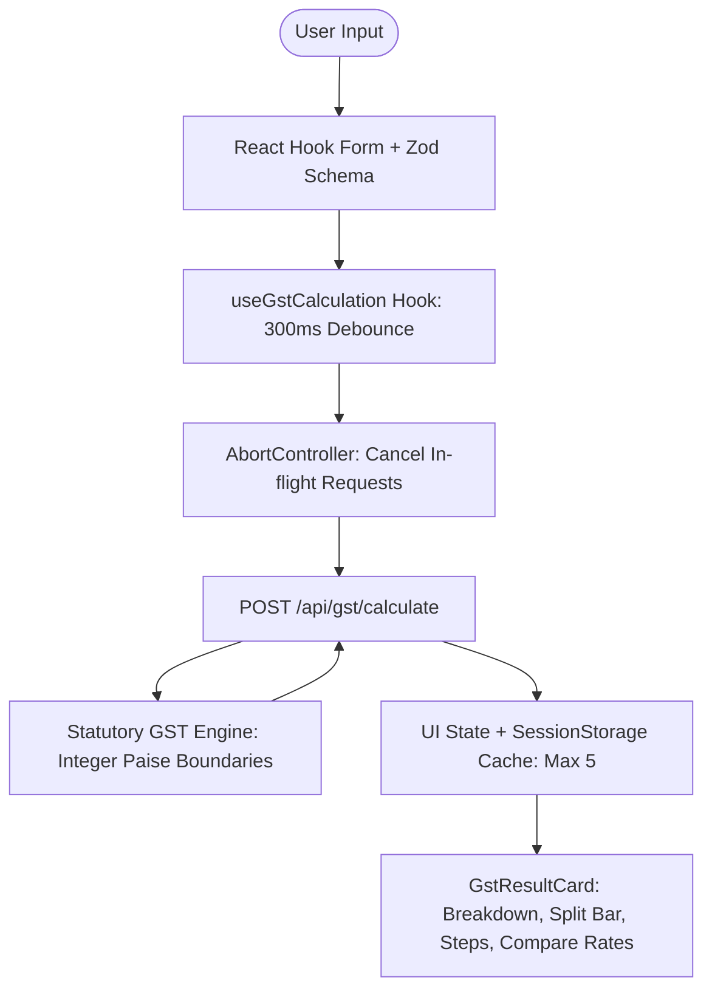

# GST Feature Module (Phase 4)

TaxGenie GST calculation engine, user interface, statutory state and rate lookups, and session persistence.

---

## 1. Architecture & Data Flow



### Flow Breakdown:
1. **Form Management & Validation:**
   - React Hook Form paired with Zod schema (`src/features/gst/schema.ts`).
   - Fields: `amount` (required, > 0, max 2 decimals, max 100 Crore), `rate` (restricted to statutory allowed rates `[0, 5, 18, 40]`), `mode` (`"add"` or `"remove"`), `sellerState`, `buyerState`, and `sameState` boolean.
   - Server-side validation errors are mapped back to form fields cleanly.

2. **Debounce & Request Cancellation:**
   - Managed by `useGstCalculation` (`src/features/gst/hooks/useGstCalculation.ts`).
   - In-flight HTTP requests are automatically cancelled using `AbortController` whenever user input changes within ~300ms.
   - Stale responses arriving out of order are discarded so newer inputs never get overwritten.
   - If the backend API is temporarily offline, a local pure integer paise calculation engine (`calculateLocalGst`) provides a seamless fallback experience.

3. **Session Persistence:**
   - Remembers the user's selected `sellerState` across page loads via `sessionStorage`.
   - Automatically maintains the last 5 calculations in `sessionStorage` (`taxgenie_gst_history`).
   - Clear privacy indication to the user: calculations are stored exclusively on their local device and only for the active session.

4. **Multi-state Tax Splitting:**
   - Intra-state (`sellerState === buyerState`): Split into equal **CGST** and **SGST** portions (e.g. 18% -> 9% CGST + 9% SGST).
   - Inter-state (`sellerState !== buyerState`): Combined single **IGST** portion (e.g. 18% -> 18% IGST).
   - "Buyer is in the same state" checkbox locks `buyerState = sellerState` and displays the supply badge `Same state (CGST + SGST)`.

5. **Compare Rates:**
   - The expandable mini-table calculates and compares what the same input amount would cost across all allowed statutory slabs (`0%`, `5%`, `18%`, `40%`).
   - Lazy calculation: only computed/fetched when the user expands the section.

---

## 2. File & Directory Structure

```text
Client/src/
├── features/gst/
│   ├── components/
│   │   ├── CompareRates.tsx         # Lazy-loaded rate comparison mini table
│   │   ├── GstResultCard.tsx        # Live calculation breakdown, copy, and invoice preview CTA
│   │   ├── GstSplitBar.tsx          # Accessible stacked horizontal bar (Base vs GST)
│   │   ├── ItemRateSearch.tsx       # Searchable goods & services rate picker
│   │   ├── ModeToggle.tsx           # Segmented "Add GST" / "Remove GST" toggle
│   │   ├── RateChips.tsx            # Radio group for statutory rates (0%, 5%, 18%, 40%)
│   │   ├── RecentCalculations.tsx   # Session calculation history (max 5) with "Use again"
│   │   └── StateSelect.tsx          # Searchable Seller & Buyer state dropdowns + same state checkbox
│   ├── data/
│   │   ├── commonGstItems.json      # ~20 curated goods/services with HSN, category, and verified: false
│   │   └── commonGstItems.ts        # Typed export of common GST items
│   ├── hooks/
│   │   └── useGstCalculation.ts     # Debounced calculation hook with cancellation & history
│   ├── utils/
│   │   └── money.ts                 # Integer paise conversions, INR formatter, amount in words
│   ├── api.ts                       # API service layer with RTK Query and fallback cache
│   ├── schema.ts                    # Zod validation schema and form types
│   ├── types.ts                     # TypeScript shared interfaces
│   └── __tests__/
│       ├── GstIntegration.test.tsx  # Complete 13-scenario integration test suite
│       └── money.test.ts            # Money conversions, edge cases, and words unit tests
├── pages/gst/
│   ├── GstCalculatorPage.tsx        # Two-column desktop / single-column mobile GST calculator
│   └── InvoicesComingSoonPage.tsx   # Phase 6 invoice generator preview page
```

---

## 3. How to Add a New Item to "Find the rate for my item"

Common GST items are stored in `Client/src/features/gst/data/commonGstItems.json` and mirrored in `Client/src/features/gst/data/commonGstItems.ts`.

### Step 1: Add the entry to `commonGstItems.json` and `commonGstItems.ts`
Each entry requires:
- `id`: Unique kebab-case identifier (e.g., `"organic-honey"`).
- `name_en`: Natural English name (e.g., `"Organic Honey"`).
- `name_hi`: Natural Hindi translation (e.g., `"जैविक शहद"`).
- `rate`: Must be one of the supported rates (`0`, `5`, `18`, `40`).
- `category`: Category group (e.g., `"Food & Groceries"`, `"Professional Services"`).
- `hsn`: *(Optional)* 4-digit or 6-digit HSN/SAC code (e.g., `"0409"`).
- `verified`: `false` *(Keep `false` until officially verified against the latest GST notifications)*.

Example:
```json
{
  "id": "legal-services",
  "name_en": "Legal Services by Advocate / Firm",
  "name_hi": "वकील / कानूनी फर्म द्वारा विधिक सेवाएं",
  "rate": 18,
  "category": "Professional Services",
  "hsn": "9982",
  "verified": false
}
```

> **Note:** The UI renders an advisory banner: *"Rates shown are a guide. Please confirm for your exact product or service."*

---

## 4. How to Add a New Statutory GST Rate

If statutory GST rates are updated (e.g., introduction of a new reform rate):

1. **Backend Engine (`Backend/src/engine/gst/calculate.ts`):**
   - Update `SUPPORTED_GST_RATES` array to include the new rate:
     ```ts
     export const SUPPORTED_GST_RATES = [0, 5, 18, 40, NEW_RATE] as const;
     ```
2. **Backend API Metadata (`Backend/src/controllers/gst.controller.ts`):**
   - The `/api/gst/meta` endpoint automatically reads `SUPPORTED_GST_RATES` and returns it to the client.
3. **Client Schema (`Client/src/features/gst/schema.ts`):**
   - Update `allowedRates` in `createGstFormSchema`:
     ```ts
     rate: z.number().refine((val) => [0, 5, 18, 40, NEW_RATE].includes(val), { ... })
     ```
4. **Client API Fallbacks (`Client/src/features/gst/api.ts`):**
   - Update `FALLBACK_RATES`:
     ```ts
     export const FALLBACK_RATES = [0, 5, 18, 40, NEW_RATE] as const;
     ```
5. **Localization (`Client/src/i18n/locales/en.json` & `hi.json`):**
   - Add plain-language label and description for the new rate under `"gst"`.
