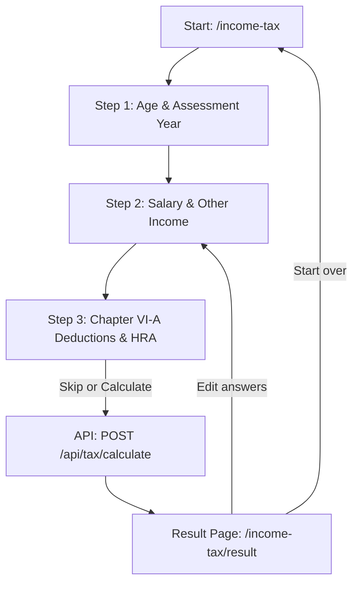

# Income Tax Calculator & Comparison Engine (Phase 3)

TaxGenie Phase 3 implements an intuitive, beginner-friendly Indian Income Tax Calculator & Comparison UI supporting both the New Tax Regime (Section 115BAC / Budget 2025) and Old Tax Regime with itemized Chapter VI-A deductions.

---

## 1. User & Calculation Flow



1. **Step 1: About You (`AgeStep`)**
   - User selects age group: `below60`, `senior` (60 to 79), or `superSenior` (80+).
   - User chooses assessment tax year (defaults to `FY 2026-27`).
   - Tax rules are loaded dynamically from `GET /api/rules/:taxYear`.

2. **Step 2: Your Income (`IncomeStep`)**
   - User inputs salary with a **Monthly / Yearly** toggle.
   - Monthly values are automatically multiplied by 12 with live helper text: *"That is ₹X a year"*.
   - Other taxable income (bank/FD interest) is entered with a clear helper: *"Standard deduction does not apply to this"*.
   - Live amount-in-words helper in Indian numbering system (*Lakh, Crore*).

3. **Step 3: Deductions & Allowances (`DeductionsStep`)**
   - Clear info banner explaining that deductions only apply in the Old Regime.
   - *"Skip - I have no deductions"* button immediately proceeds with 0 deductions.
   - Statutory deduction fields (80C, 80D Self, 80D Parents + Senior toggle, 80CCD(1B) NPS, Home Loan Interest 24(b), HRA 10(13A)).
   - Dynamic statutory limits loaded from active tax rules.
   - Live progress meter (*"₹80,000 of ₹1,50,000 used"*).
   - Amber warning notice when exceeding limit (*"Only ₹1,50,000 counts. We will use the limit."*).
   - Live HRA calculation using statutory Section 10(13A) rule.

4. **Result Screen (`/income-tax/result`)**
   - **Savings Banner**: Highlights recommended regime and annual savings in green.
   - **Side-by-side Regime Cards**: New vs Old with large bold Total Tax, effective rate, monthly rate, and *Recommended* badge.
   - **Break-Even Hint Card**: Explains deductions required for Old Regime to win.
   - **Engine Warnings Callout**: Maps engine warnings (`DEDUCTION_CAPPED`, `SURCHARGE_NOT_INCLUDED`, `REBATE_APPLIED`, `MARGINAL_RELIEF_APPLIED`, `OTHER_INCOME_NO_STANDARD_DEDUCTION`).
   - **Comparison Chart**: Recharts bar chart with Grouped (Total Tax) and Stacked (Tax + Cess) views and screen-reader data table.
   - **Calculation Breakdown**: Expandable vertical timeline of engine steps and slab table.
   - **Actions**: Save (login modal for guests), Ask AI (coming in Phase 7), Download PDF (tooltip coming soon), Edit Answers, and Start Over.

---

## 2. State Shape & Persistence

Wizard state is managed by `WizardProvider` in React context and persisted automatically in `sessionStorage` under `taxgenie_income_tax_wizard` and `taxgenie_income_tax_result`. Refreshing the browser or navigating steps retains all entries.

```typescript
export interface IncomeTaxFormData {
  // Step 1
  ageGroup: "below60" | "senior" | "superSenior";
  taxYear: string;

  // Step 2
  salaryPeriod: "yearly" | "monthly";
  salaryAmount: number; // raw value
  otherIncome: number;

  // Step 3
  sec80C: number;
  sec80CCD1B: number;
  sec80D_selfFamily: number;
  sec80D_parents: number;
  parentsAreSenior: boolean;
  homeLoanInterest: number;

  // HRA
  hasHra: boolean;
  hraBasicSalary: number;
  hraReceived: number;
  hraRentPaid: number;
  hraIsMetro: boolean;
}
```

---

## 3. How to Add a New Deduction Field

To add a new statutory deduction (e.g., Section 80E for Higher Education Loan Interest, or Section 80G for Donations):

1. **Update Types (`types.ts`)**:
   - Add the field to `TaxDeductionsInput` (e.g., `sec80E?: number`).
   - Add the field to `IncomeTaxFormData` (e.g., `sec80E: number`).

2. **Update Validation Schema (`schema.ts`)**:
   - Add `sec80E: z.number().int().min(0).max(MAX_SENSIBLE_AMOUNT).default(0)` into `step3Schema`.

3. **Update Deductions UI (`steps/DeductionsStep.tsx`)**:
   - Retrieve any limit from `activeRules?.oldRegime?.deductionLimits`.
   - Render `FieldWithTooltip` + `CurrencyInput` + `LimitMeter`:
     ```tsx
     <FieldWithTooltip
       id="sec80E"
       label={t("incomeTax.deductions.sec80E.label")}
       tooltip={t("incomeTax.deductions.sec80E.tooltip")}
       limit={sec80ELimit}
       error={errors.sec80E?.message ? t(errors.sec80E.message) : undefined}
     >
       <Controller
         name="sec80E"
         control={control}
         render={({ field }) => (
           <CurrencyInput
             id="sec80E"
             name="sec80E"
             value={field.value}
             onChange={field.onChange}
             onBlur={field.onBlur}
           />
         )}
       />
     </FieldWithTooltip>
     <LimitMeter current={sec80E} limit={sec80ELimit} />
     ```

4. **Update Payload Builder (`WizardContext.tsx`)**:
   - In `buildPayload(dataToUse)`, add `sec80E: Math.round(dataToUse.sec80E || 0)` into `payload.deductions`.

5. **Update i18n Translations (`en.json` & `hi.json`)**:
   - Add labels, tooltips, and examples under `incomeTax.deductions.sec80E`.

---

## 4. Internationalization & Accessibility

- 100% of visible copy is localized in `en.json` and `hi.json`.
- Tested with screen-readers using `role="radiogroup"`, `role="status"`, `aria-live="polite"`, `aria-invalid`, and semantic table markups.
- Full responsive support from 360px mobile up to wide 4K screens.
- Dark mode and light mode color tokens adhere to accessibility contrast guidelines.
